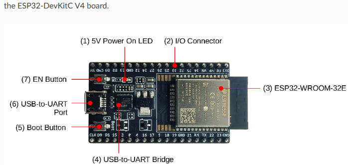
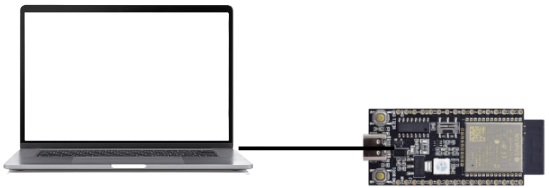
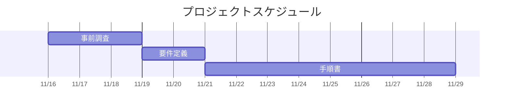

# ESP32-WROOM-32E_要件定義書v.1.0
## 改訂履歴
| 改訂番号 | 改訂箇所          | 改訂内容 | 改訂日(作成日) | 改訂者(作成者)  |
| -------- | ---------------- | -------- | ------------ | -------------- |
| 初版     | -                | -        | 2026/11/19   | E1      |
|          |                  |          |              |                |

## 目次
- [1. はじめに](#1-はじめに)
- [2. 概要](#2-概要)
    - [2.1. マイコンボードの構成](#21-マイコンボードの構成)
    - [2.2. 対象範囲](#22-対象範囲)
    - [2.3. 前提条件](#23-前提条件)
- [3. 要件](#3-要件)
- [4. 体制/スケジュール](#4-体制スケジュール)
    - [4.1. プロジェクト体制](#41-プロジェクト体制)
    - [4.2. 期限](#42-期限)
    - [4.3. スケジュール](#43-スケジュール)

## 1. はじめに
本書は、ESP32-WROOM-32Eを用いたマイコンボードの開発手順書を作成するための要件定義書である。  
開発手順書は既存の手順書テンプレートを使用し、開発環境構築からデバッグまでとトラブルシューティングを記載する。  
参考資料は次の2点を使用する。  
- ESP32-WROOM-32E 編 手順書づくりの進め方
- 手順書テンプレートの使い方

## 2. 概要
ESP32-WROOM-32Eを用いたマイコンボードの開発手順書を読めば、だれでも対象のマイコンボードを動かせることを目的としている。    
本章では、マイコンボードの構成と配線について説明する。

### 2.1. マイコンボードの構成
マイコンボードとは、マイコン（MicroController Unit）を動かすために必要な電源回路・入出力端子・書き込み回路などを一枚の基板に纏めた開発用ハードウェアである。  
使用する利点は、基板設計をゼロから構築せずに、そのままプログラムを書き込んで動作確認できることである。  
ESP32-WROOM-32Eを用いたマイコンボード(ESP32-DevKitC V4)の構成図を示す。  
#### 図1. マイコンボード本体の構成図

 

### 2.2. 対象範囲
ESP32-WROOM-32Eを用いたマイコンボード(ESP32-DevKitC V4)は、動作確認するPCとUSB接続する。
配線図は次に示す。
#### 図2. 配線図 

 

### 2.3. 前提条件
動作確認を行うPCに接続する機器（例：ESP32-WROOM-32Eを用いたマイコンボード）は予め用意されていること。  
また、PC側の条件は次に示す。  
- 開発ツールはVSCodeとESP-IDFを使用する。
- 使用しているPCにVSCodeをインストールした後、VSCodeの拡張機能としてESP-IDFをインストールする。
- 言語はC言語を使用する。
- ツールやドライバのバージョンは手順書作成メンバー間で統一する。

## 3. 要件
- 手順書の章立ては0章から8章までの全9章とし、各章の項目はテンプレートに従う。
- 0章には概要を記載する。
- 1章には開発環境構築手順を記載する。
- 2章にはシリアルターミナルの使い方を記載する。
- 3章にはプロジェクト作成手順を記載する。
- 4章「コーディング・ビルド・書込み(RTOSなし)」は、本マイコンがRTOSでの動作を前提としているため記載しない。ただし章は残し、記載していない理由をそこに書く。
- 5章にはコーディング・ビルド・書込み(FreeRTOS)の手順を記載する。
    - 手順書5章の題材1～4は自分でタスクを作らず、app_mainの中で処理を記述する。
    - 手順書5章の題材5・6はFreeRTOSのAPI関数を使用したコーディングにする。
- 6章にはデバッグ手順を記載する。
- 7章にはトラブルシューティングを記載する。
- 8章には参考資料を記載する。

## 4. 体制/スケジュール
開発を推進するための実行体制とスケジュールを明確にする。
### 4.1. プロジェクト体制
メンバーの一覧を次に示す。
#### 表2. メンバー一覧
| チームメンバー | 役割 |担当|
| -------------- | ---- | ---- |
| 奥村幸之丞 | リーダー | E1 |
| 永山善規 | メンバー | E2, E3 |

### 4.2. 期限
<!--変更箇所-->
2026年12月01日

### 4.3. スケジュール
<!--変更箇所-->
各プロセスの開始予定日・終了予定日・参加人数・工数見積もり次に示す。
#### 表3. スケジュール
| プロセス | 開始予定日     | 終了予定日     | 人数 | 工数見積もり |
| ------- | ------------- | ------------- | ---- | ------------ |
| 事前調査 | 2026年11月16日 | 2026年11月18日 | 2人 | 6人日 |
| 要件定義 | 2026年11月19日 | 2026年11月20日 | 2人 | 4人日 |
| 手順書   | 2026年11月24日 | 2026年12月01日 | 2人 | 12人日 |

#### 図3. ガントチャート

