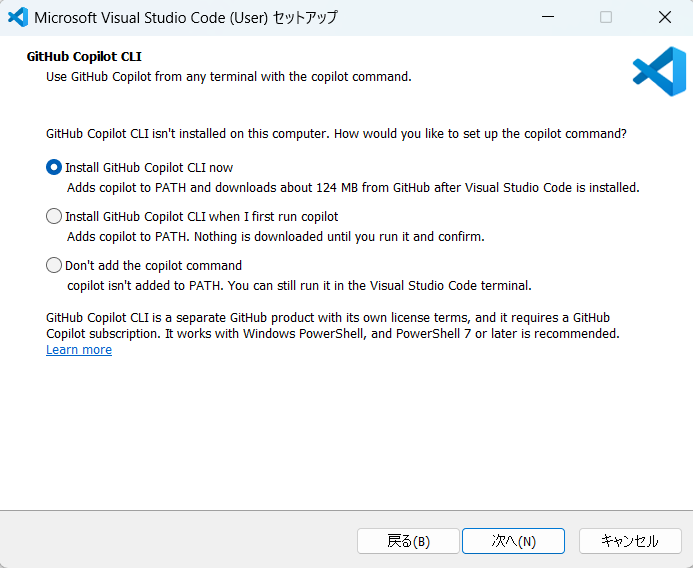
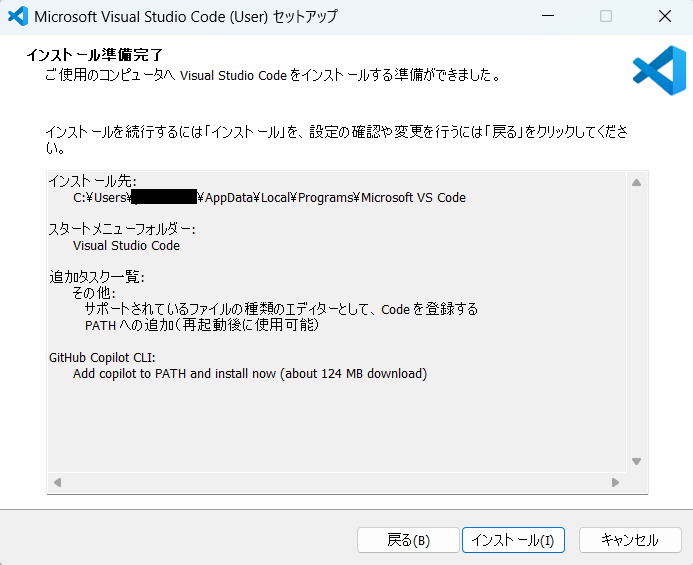
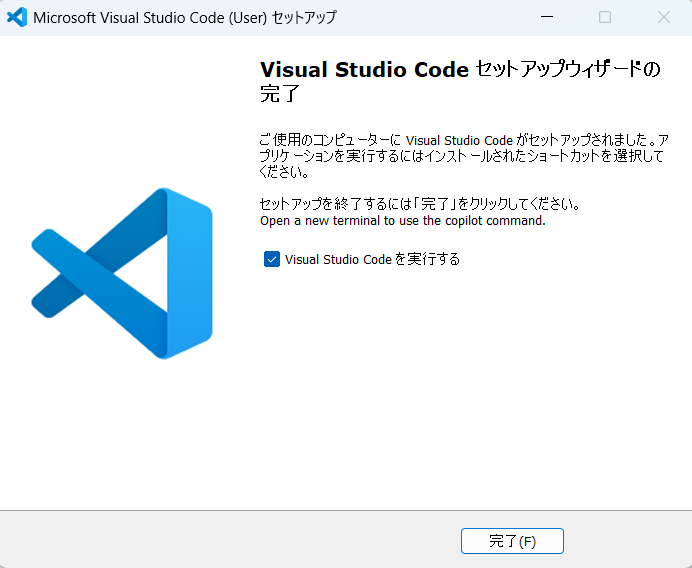
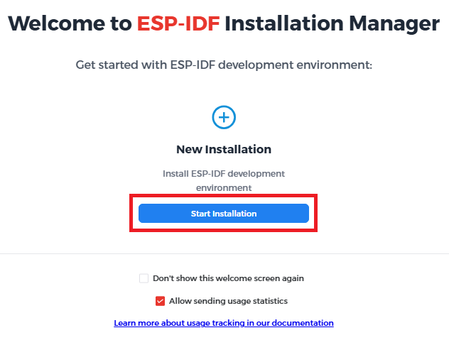
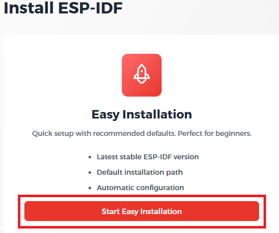
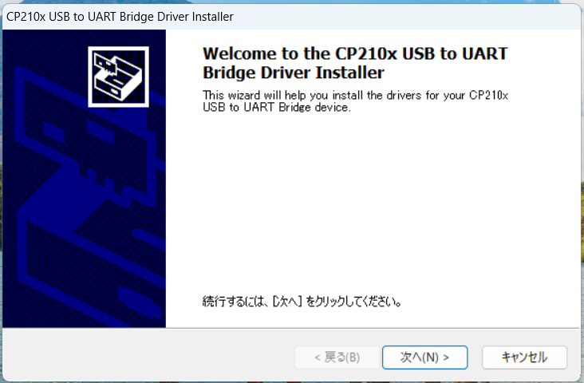
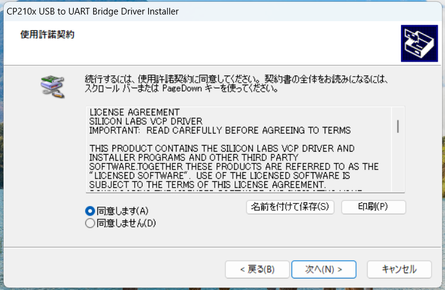

<!--
  手順書テンプレート(全ボード共通)
  - このファイルをコピーして、ボードごとのフォルダに保存してから書き始める。
  - 章の番号と名前は変えない。該当しない章は消さずに「本ボードでは作成しない(理由:〜)」と書く。
  - ボード独自の内容は、第9章以降に追加章として書く。
  - このコメントはプレビューには表示されない。消さずに残してよい。
-->

# 【ESP32_WROOM_32E】開発手順書

| 項目 | 内容 |
|---|---|
| 対象ボード | ESP32_WROOM_32E |
| 開発言語 | C言語 |
| IDE・ツール | VS Code ver1.146.0 |
||ESP-IDF Extension ver2.3.0|
||ESP-IDF Installation Maneger ver0.21.1|
||CP210x Windows Drivers ver6.7.6|
| SDK・ライブラリ | ESP-IDF ver6.1 |
| 開発PCのOS | Windows 11 26H2 |
| 最終検証日 | 2026/11/20 |

## 改版履歴

| 版 | 日付 | 担当者 | 内容 |
|---|---|---|---|
| 0.1 | 2026/11/13 | E1 | 新規作成 |
| 0.2 | 2026/11/20 | E1 | 第0章を追加 |
| 0.3 | 2026/11/24 | E2 | 第5章を追加 |
| 0.4 | 2026/11/24 | E1 | 第1章を追加 |
---

## 0. 概要

### 0.1 この手順書でできること
<!-- 読者がこの手順書を最後まで進めると何ができるようになるかを書く -->
本手順書を最後まで進めることで、ESP32-WROOM-32Eの接続方法とプロジェクト作成およびプログラムの動作の確認が可能となる。  
それによりESP32-WROOM-32Eを用いた、FreeRTOS有りの組み込み開発ができるようになる。

### 0.2 必要な機材
必要な機材を次の表に示す。
#### 表1.必要機材一覧
| 品名 | 数量 | 備考 |
|---|---|---|
| ESP32-DevKitC V4(ESP32-WROOM-32E) | 1人1台 | 開発するボード本体 |
| USBケーブル(micro-B、データ通信対応) | 1人1本 | 給電・書込み・モニタ用 |
| ESP-PROG(JTAGデバッガ) | 1セット | デバッグ用 |
| ブレッドボード・ジャンパワイヤ | 1人1式 | LED・ボタン・JTAGの配線 |
| LED・抵抗(330Ω 程度) | 1人1組 | 題材1・2・4・5・6で使用 |
| タクトスイッチ | 1人1個 | 題材2・3・5・6で使用 |

### 0.3 前提知識・事前準備
<!-- 既存の Git/GitHub 運用・Redmine 運用を参考に、前提とする知識と準備を書く -->
#### 開発の前提条件
開発にあたって次に示す内容を確認しておくこと。
- 開発は[技術資料](http://hst-saba:3000/675802efc7569e701fb1c2ee)に記載された手順に沿って進める。  
- ツールやドライバのバージョンはメンバー間で統一する。 

#### 開発対象マイコンの概要
ESP32-WROOM-32Eとは
Espressif Systems社の、Wi-Fi・Bluetooth通信機能を内蔵したIoT向けマイコンモジュール。  
デュアルコアCPUを搭載しており、GPIOやUART、SPI、I2Cなどの豊富な周辺機能を利用できる。  
FreeRTOSを利用したマルチタスク処理に対応しており、センサー制御や無線通信など、さまざまな組み込みシステムの開発に使用される。  

#### 用語解説
- マイコン  
マイコン（Microcontroller Unit, MCU）とは、CPU・メモリ・入出力（I/O）などを1つのICに集積した小型コンピュータのこと。  
家電や自動車などの電子機器を制御するために使われる。  

- GPIO  
GPIO(General Purpose Input/Output)とは、汎用的に使用できる入出力ポートのこと。  
センサの値やスイッチのオンオフを入力信号として伝えたり、LEDを光らせる出力信号を伝えたりすることができる。  
プログラム上でピンの番号を指定して利用する。

- UART  
UARTとは、データを1ビットずつ順番に送受信するシリアル通信方式のこと。  
マイコンとPCや他の電子機器との間で、データの送受信に使用される。  
ESP32では、プログラムの書き込みやログの確認などに利用される。  

- JTAG  
JTAGとは、マイコンなどの内部状態を確認したり、プログラムのデバッグを行ったりするためのインターフェース規格のこと。  
ブレークポイントの設定やステップ実行、変数の確認などに使用される。  
ESP32では、専用のJTAGデバッガ(例：ESP-PROG)を接続することで、プログラムの実行状態を確認できる。  

---

## 1. 開発環境構築

### 1.1 ツールのインストール
#### VS Code インストール手順
1. VSCode公式の[ダウンロードページ](https://code.visualstudio.com/download)へアクセスし、Windows向けインストーラをダウンロードする。 
 

1. ダウンロードしたインストーラ`VSCodeUserSetup-x64-1.147`を実行する。
1. 「同意する」にチェックを入れて「次へ」を押下する。 
 

1. インストール先を指定して「次へ」を押下する。 
 

1. 「次へ」を押下する。 
 

1. 「次へ」を押下する。 
 

1. 「次へ」を押下する。 
 

1. 「インストール」を押下する。 
 

1. 完了ボタンまで進んだらインストール完了。 
 

#### ESP-IDF Extension インストール手順
1. 画像の①からVSCodeの拡張機能を開く。 
1. 画像の②にESP-IDFと入力し検索する。 
1. 画像の③をクリックしてESP-IDFのインストールページを開く。 
 

1. Installボタンをクリックしてインストールする。 
 

#### ESP-IDF Installation Maneger ダウンロード手順
1. Espressifの[公式ダウンロードページ](https://dl.espressif.com/dl/eim/)にアクセスする。 
1. `eim-gui-windows-x64.exe`をダウンロードする。 
 

#### ESP-IDF 本体インストール手順
1. `eim-gui-windows-x64.exe`を実行する

1. Start Installationを押下する。 
 

1. Start Easy Installationを押下する。 
 

1. インストールするESP-IDFのバージョンを選択する。 
 

1. 1. Start Installationを押下する。 
 

1. インストールを待つ。(15分～30分程度) 
 

1. インストール完了画面が出たことを確認する。 
 

### 1.2 ドライバのインストール
#### CP210x Windows Drivers インストール手順
1. [ドライバダウンロードページ](https://www.silabs.com/software-and-tools/usb-to-uart-bridge-vcp-drivers?tab=downloads)へアクセスする。 
1. CP210x Windows Driversを押下する。(zipファイルがダウンロードされる) 
 
1. ダウンロードしたzipファイルを任意の場所に解凍する。 
1. `CP210xVCPInstaller_x64`を実行する。 
1. 「次へ」を押下する。 
 
1. 「同意します」にチェックを入れて「次へ」を押下する。 
 
1. 完了画面を確認する。 
 

### 1.3 インストールできたことの確認
下記2点の確認をもってインストール完了とする。 
- ESP-IDF WelcomeからNew projectを選択して画面上部にESP-IDF v6.1が出ること。 
 
- マイコンをPCと接続したときデバイスマネージャーでCOMx(例：COM5)としてポートが表示されること。 
 

## 2. シリアルターミナルの使い方

### 2.1 使用するツールと接続方法
### 2.2 通信設定(ポート、ボーレートなど)
### 2.3 動作確認

## 3. プロジェクト作成

### 3.1 新規プロジェクトの作成
### 3.2 プロジェクトの構成(フォルダ・ファイルの役割)

## 4. コーディング・ビルド・書込み(RTOSなし)

<!-- 各題材の節は「作るもの → 配線 → プログラム → ビルドと書込み → 動作確認」の順で書く -->

### 4.1 題材1:LED点滅
### 4.2 題材2:ボタン入力
### 4.3 題材3:UART出力
### 4.4 題材4:タイマ割込み

## 5. コーディング・ビルド・書込み(FreeRTOS)
FreeRTOSとは、組み込みシステム向けに設計された軽量・オープンソースのRTOS（Real-Time Operating System）である。
また、RTOSとは、決められた期限内に処理を完了することを保証する組込み向けOSである。
FreeRTOSを導入することにより、次の利点がある。
- マルチタスク管理、割り込み処理など、組み込み開発に必要な機能を利用できる
- 複数の処理（通信、表示更新など）を並列に実行できる

### 5.1 FreeRTOSの導入・設定
FreeRTOSは、本手順書の「1.1 ツールのインストール」でインストールしたESP-IDF(Espressif IoT Development Framework)に組み込まれている。

#### 5.1.1 FreeRTOSの導入
FreeRTOSは本手順書の「1.1 ツールのインストール」で既に導入されている為、対応しない。

#### 5.1.2 FreeRTOSの設定変更
本研修ではFreeRTOSの設定を変更しない為、対応しない。

本章では、別の機会でFreeRTOSの設定を変更する場合を考慮して、設定方法と設定手順を次に示す。
##### FreeRTOSの設定方法
FreeRTOSの設定は、vscode内で表示するプロジェクトの設定画面（menuconfig）で行う。
（FreeRTOSの設定変更は、既に用意されている機能の有効と無効を決定するのみの為、マウスクリックやEnterキー押下で設定を切り替えることができる。）

##### FreeRTOSの設定手順
1. vscodeをアクティブにして、「F1」キーを押下する。
1. vscodeの画面上部で「ESP-IDF:Open Classic Menuconfig Terminal」の項目を押下する。
1. Windows PowerShellが自動実行される為、自動終了するまで待機する。
1. プロジェクトの設定画面（menuconfig）が、vscode内に表示されたら、"Compornent Config"を選択する。
1. プロジェクトの設定画面の表示が更新されたら、"FreeRTOS"を選択する。
1. FreeRTOSの設定内容が表示される。

### 5.2 題材5:複数タスク
#### 5.2.1 作るもの
本章では、ボード内にある外付けの LED とボタンを用いて、LEDタスクとボタンタスクを動かすプログラムを作成する。
タスクの作成は、API関数のxTaskCreate()を使用する。

##### xTaskCreate()の概要
xTaskCreate()で設定する引数の意味を次に示す。

    BaseType_t xTaskCreate(
      TaskFunction_t pvTaskCode,   // タスクとして実行する関数名
      const char * const pcName,   // デバッグ用に表示するタスク名
      const uint32_t usStackDepth, // タスクに割り当てるスタックの大きさ
      void *pvParameters,          // タスクに渡す引数（不要ならばNULL）
      UBaseType_t uxPriority,      // タスクの優先度（数値が大きいほど高優先度）
      TaskHandle_t *pvCreatedTask  // タスクを動かすコアを指定（不要ならばNULL）
    );

#### 5.2.2 配線
LEDの配線は、本手順書の「4.1 題材1:LED点滅」を参照する。
ボタンの配線は、本手順書の「4.2 題材2:ボタン入力」を参照する。

#### 5.2.3 プログラム
複数タスク(LEDタスクとボタンタスク)を用いたプログラムを次に示す。

    #include "freertos/FreeRTOS.h"
    #include "freertos/task.h"
    #include "driver/gpio.h"
    #include "esp_log.h"

    #define LED_GPIO    25  // LEDピン番号
    #define BUTTON_GPIO 26  // ボタンピン番号

    void led_task(void *);      // LED制御タスク
    void button_task(void *);   // ボタン監視タスク

    static bool led_on = false; // LED状態管理
    static const char *TAG = "CORE_INFO";

    void app_main(void)
    {
        // LED GPIO設定
        gpio_config_t io_conf = 
        {
            .pin_bit_mask = (1ULL << LED_GPIO),
            .mode = GPIO_MODE_OUTPUT,
            .pull_up_en = GPIO_PULLUP_DISABLE,
            .pull_down_en = GPIO_PULLDOWN_DISABLE,
            .intr_type = GPIO_INTR_DISABLE
        };
        gpio_config(&io_conf);

        // ボタン GPIO設定（入力 + プルアップ）
        io_conf.pin_bit_mask = (1ULL << BUTTON_GPIO);
        io_conf.mode = GPIO_MODE_INPUT;
        io_conf.pull_up_en = GPIO_PULLUP_ENABLE;
        gpio_config(&io_conf);

        // タスク起動
        xTaskCreate(led_task, "LED Task", 2048, NULL, 5, 0);
        xTaskCreate(button_task, "Button Task", 2048, NULL, 5, 0);
    }

    void led_task(void *pvParameters) 
    {
        while (1) 
        {
            // GPIOピンの出力レベルを設定(0->Low, 1->High)
            gpio_set_level(LED_GPIO, led_on ? 1 : 0);
            // Delay(500ms)
            vTaskDelay(pdMS_TO_TICKS(500));
        }
    }

    void button_task(void *pvParameters) 
    {
        while (1) 
        {
            // GPIOピンの出力レベルを取得
            if (gpio_get_level(BUTTON_GPIO) == 0) 
            { 
                // 押下検出（押されたらLED状態切り替え）
                led_on = !led_on;
                ESP_LOGI("BUTTON", "LED state changed: %d", led_on);
                // チャタリング（スイッチやボタンなどの接点が安定する前に短時間でON/OFFを繰り返す現象）防止
                vTaskDelay(pdMS_TO_TICKS(300));
            }
            // Delay(50ms)
            vTaskDelay(pdMS_TO_TICKS(50));
        }
    }

#### 5.2.4 ビルドと書込み
本手順書の「2.3 動作確認」と同様の対応をする。

#### 5.2.5 動作確認
ビルド成功後、次の確認を行う。
- マイコンボードのボタンを押すことで、LEDの表示でON/OFFが切り替わることを確認する。
- マイコンボードのボタンを押し続けることで、LEDの表示が点滅することを確認する。
- マイコンボードのボタンを押すことで、vscodeのターミナルに次の2点が交互に表示されることを確認する。
  * BUTTON: LED state changed: 1
  * BUTTON: LED state changed: 0

### 5.3 題材6:タスク間通信
#### 5.3.1 作るもの
本章では、ボード内にある外付けの LED とボタンを用いて、キューで LED の点滅の速さを切り替えるプログラムを作成する。
キューとはタスクの間でデータを交換するための仕組みである。
キューの作成は、API関数のxQueueCreate()関数を使用する。
また、キューの送信と受信は、API関数のxQueueSend()関数とxQueueReceive()関数を使用する。

##### xQueueCreate()の概要
xQueueCreate()で設定する引数の意味を次に示す。

    QueueHandle_t xQueueCreate( 
      UBaseType_t uxQueueLength,  // キューが収容可能なアイテムの最大数
      UBaseType_t uxItemSize      // キューの各項目が必要とするバイト数
    );

##### xQueueSend()の概要
xQueueSend()で設定する引数の意味を次に示す。

    BaseType_t xQueueSend(
      QueueHandle_t xQueue,       // キューのハンドル
      const void *pvItemToQueue,  // 送信データのポインタ
      TickType_t xTicksToWait     // キューが満杯の場合の待ち時間
    );

##### xQueueReceive()の概要
xQueueReceive()で設定する引数の意味を次に示す。

    BaseType_t xQueueReceive(
      QueueHandle_t xQueue,       // キューのハンドル
      void *pvBuffer,             // 受信データのポインタ
      TickType_t xTicksToWait     // キューが空の場合の待ち時間
    );

#### 5.3.2 配線
LEDの配線は、本手順書の「4.1 題材1:LED点滅」を参照する。
ボタンの配線は、本手順書の「4.2 題材2:ボタン入力」を参照する。

#### 5.3.3 プログラム
キューを用いたタスク間通信のプログラムを次に示す。

    #include "freertos/FreeRTOS.h"
    #include "freertos/task.h"
    #include "freertos/queue.h"
    #include "driver/gpio.h"
    #include "esp_log.h"

    #define LED_GPIO    25  // LEDピン番号
    #define BUTTON_GPIO 26  // ボタンピン番号

    static QueueHandle_t speed_queue;       // キューのハンドル
    static const char *TAG = "BlinkQueue";  // ログ出力タグ

    void button_task(void *);   // ボタンタスク
    void led_task(void *);      // LEDタスク

    void app_main(void) 
    {
        // LED GPIO設定
        gpio_config_t io_conf = 
        {
            .pin_bit_mask = (1ULL << LED_GPIO),
            .mode = GPIO_MODE_OUTPUT,
            .pull_up_en = GPIO_PULLUP_DISABLE,
            .pull_down_en = GPIO_PULLDOWN_DISABLE,
            .intr_type = GPIO_INTR_DISABLE
        };
        gpio_config(&io_conf);

        // ボタン GPIO設定
        gpio_config_t btn_conf = 
        {
            .pin_bit_mask = (1ULL << BUTTON_GPIO),
            .mode = GPIO_MODE_INPUT,
            .pull_up_en = GPIO_PULLUP_ENABLE,
            .pull_down_en = GPIO_PULLDOWN_DISABLE,
            .intr_type = GPIO_INTR_DISABLE
        };
        gpio_config(&btn_conf);

        // キュー作成
        speed_queue = xQueueCreate(5, sizeof(int));
        if (speed_queue == NULL) 
        {
            ESP_LOGE(TAG, "Failed to create queue");
            return;
        }

        // タスク作成
        xTaskCreate(button_task, "button_task", 2048, NULL, 5, NULL);
        xTaskCreate(led_task, "led_task", 2048, NULL, 5, NULL);
    }

    void button_task(void *pvParameters) 
    {
        int speeds[] = {100, 300, 700}; // 点滅周期(ms)
        int index = 0;                  // 位置情報

        while (1) 
        {
            // ボタン押下検知
            if (gpio_get_level(BUTTON_GPIO) == 0) 
            {
                index = (index + 1) % 3;
                int new_speed = speeds[index];
                ESP_LOGI(TAG, "Button pressed, new speed: %d ms", new_speed);

                // キューに送信が失敗
                if (xQueueSend(speed_queue, &new_speed, pdMS_TO_TICKS(100)) != pdTRUE) 
                {
                    ESP_LOGW(TAG, "Failed to send speed to queue");
                }
                // チャタリング（スイッチやボタンなどの接点が安定する前に短時間でON/OFFを繰り返す現象）防止
                vTaskDelay(pdMS_TO_TICKS(500));
            }
            vTaskDelay(pdMS_TO_TICKS(50));
        }
    }

    void led_task(void *pvParameters) 
    {
        int current_speed = 500;    // 初期速度
        int new_speed;              // キューから取得する速度

        while (1) 
        {
            // キューから速度を受信
            if (xQueueReceive(speed_queue, &new_speed, pdMS_TO_TICKS(10)) == pdTRUE) 
            {
                current_speed = new_speed;
                ESP_LOGI(TAG, "Speed updated to %d ms", current_speed);
            }

            // LED点滅
            gpio_set_level(LED_GPIO, 1);
            vTaskDelay(pdMS_TO_TICKS(current_speed));
            gpio_set_level(LED_GPIO, 0);
            vTaskDelay(pdMS_TO_TICKS(current_speed));
        }
    }

#### 5.3.4 ビルドと書込み
本手順書の「2.3 動作確認」と同様の対応をする。

#### 5.3.5 動作確認
ビルド成功後、次の確認を行う。
- マイコンボードのボタンを押すことで、LEDの点滅表示の速度が切り替わることを確認する。
- マイコンボードのボタンを押すことで、vscodeのターミナルに速度が更新されたログが表示されることを確認する。
  例：Speed updated to 300 ms

## 6. デバッグ
デバッグ可能な機材がないため保留とする。

<!-- ### 6.1 デバッガの接続(配線図・写真) -->
<!-- ### 6.2 デバッグの開始 -->
<!-- ### 6.3 ブレークポイント・ステップ実行 -->
<!-- ### 6.4 変数・メモリ・レジスタの確認 -->

## 7. トラブルシューティング
次の表は、本手順書内で作業が手詰まりになった時に確認する。

| 症状 | 原因 | 対処 |
|---|---|---|
| サンプルの hello_world を使用しても、文頭にあるincludeの行が全てエラー表示になる。 | PCとマイコンをUSB接続した状態で初回ビルドをしていない。 | PCとマイコンをUSB接続した状態で初回ビルドする。 |
| サンプルの hello_world を使用してビルドしても「Hello world!」が表示されない。 | 本手順書で対応漏れの項目がある。 | 本手順書通りに対応し、対応できない項目があれば有識者に確認する。 |
| ビルド後、エラーメッセージ「No serial ports found.」が表示される | マイコンがPCと接続されていない。または、ポート番号がかみ合っていない。 | デバイスマネージャーを起動し、ポート番号が認証していることを確認する。 |
| ビルド後、エラーメッセージ「ERROR: A fatal error occurred: Could not open COM3, the port is busy or doesn't exist.」が表示される。 | 一方のvscodeでビルドまたは実行中の時、他方のvscodeでビルドしている。 | ビルドまたは実行時は1ファイルのみにする。 |
| ビルドは成功したが、LEDが点灯しない、ボタン操作が機能しない。 | プログラムとマイコンでPIN番号が一致していない | PIN番号を一致させる。 |

## 8. 参考資料
- 

<!-- ボード独自の追加章がある場合は、ここから「## 9. 〜」として追加する -->

<!--
  記述ルール(書きぶりを全章でそろえる)
  1. 見出し:章は「## 1. 開発環境構築」、節は「### 1.1 ツールのインストール」の形にする。
  2. 手順:番号付きリストで書き、1つの番号に1つの操作。文末は「〜する。」にそろえる。
  3. 確認:手順のあとに「> 確認:〜れば成功」と、成功したかどうかの判断方法を書く。
  4. 注意:まちがえやすい所は「> 注意:〜」と書く。
  5. 画像:画面操作にはスクリーンショットを付ける。images/ に置き、名前は担当番号から始める(例:p1_ext.png)。
  6. 図:処理の流れやタスクの関係は Mermaid で書く。配線は図か写真で、ピン番号と信号名を書く。
  7. プログラム:手順書の中にコードブロックで書き、日本語のコメントを付ける。
  8. バージョン:ツールと SDK のバージョンを書く。
  9. 用語:同じものは同じことばで書く。英数字は半角で、日本語との間に半角スペースを入れる。
  10. つまずいた点:第7章に必ず記録する。
-->
